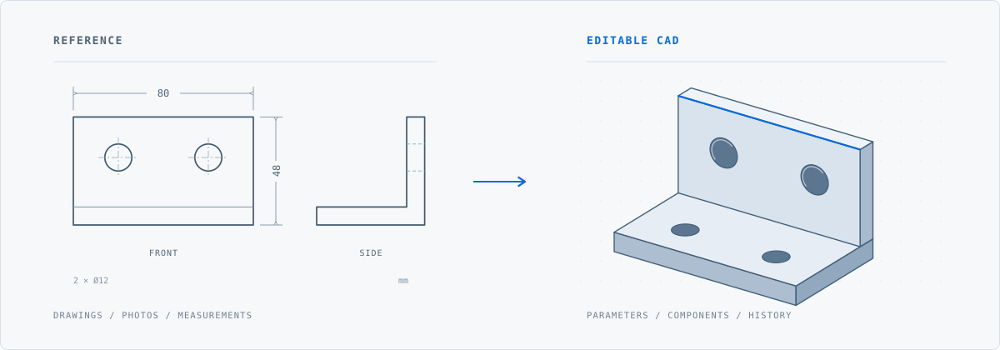

# ReCAD

**从工程图、照片和尺寸，重建可编辑 CAD。**

通用产品逆向建模 Skill，适用于机械零件、外壳、消费电子与装配体。当前在 **Autodesk Fusion** 中执行。

[下载 Skill](https://github.com/hanyu040304/recad/releases/latest/download/recad-skill.zip) · [安装说明](docs/usage.md) · [MIT](LICENSE)



| 你手上有 | ReCAD 怎么做 |
| --- | --- |
| 工程图 | 按尺寸、基准与剖面重建 |
| 照片或实物尺寸 | 查找资料、标定多视图，注明估算 |
| 已有模型 | 只修正指定部位，保留已确认的几何 |

## 开始使用

解压技能包，将技能文件夹放入代理的 skills 目录。[安装步骤 →](docs/usage.md#安装)

```text
$fusion-reverse-modeling
根据这些图纸和照片，在 Fusion 中还原这个安装支架。
保留参数和组件，交付原生设计、STEP 和尺寸核对记录。
```

**交付：** 可编辑原生设计 · STEP · 尺寸来源与核对记录。照片估算与未知项会单独标注。

[工具与更多示例](docs/usage.md#使用示例) · [验证范围](VALIDATION.md)
